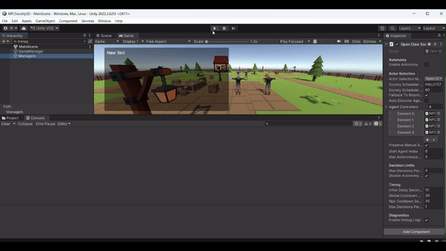

# NPC Society - AI Agents

Multi-agent NPC society built in **Unity and C#**, using LLM-driven agents with persistent memory, individual goals, social relationships and context-aware behaviour.

The project explores how autonomous NPCs can interact with each other and with a simulated environment, producing emergent social behaviour instead of relying only on predefined scripted actions.

## Demo

## Project Files

- [View Project Presentation](presentation.pdf)
- [View Full Demo Video](demo.mp4)

## Project Overview

Each NPC is designed as an autonomous agent with its own:

- Identity
- Internal state
- Memory
- Goals
- Social relationships
- Context-aware decision making

NPC behaviour is influenced by previous interactions, the current environment and relationships with other agents.

The objective is to simulate a small artificial society where behaviours such as cooperation, conflict, alliances, routines and changes in trust can emerge through agent interaction.

## Key Features

- Multi-agent NPC simulation
- Persistent agent memory
- Individual goals and internal state
- Social relationships between NPCs
- LLM-driven behaviour
- Context-aware decision making
- Emergent social interactions
- Unity-based 3D simulation environment
- OpenClaw agent integration
- Separate agent and server components

## Tech Stack

- Unity
- C#
- Python
- OpenClaw
- LLM-based agent systems
- Jupyter Notebook

## Repository Structure

    NPC-Society-AI-Agents/
    ├── OpenClaw_Agents/
    ├── OpenClaw_Server/
    ├── data/
    ├── docs/
    │   └── media/
    │       └── npc-society-demo.gif
    ├── notebooks/
    ├── scripts/
    ├── src/
    │   └── NPCSociety3D/
    ├── AOOP_Clean_Organizado.ipynb
    ├── AOOP_Clean_Organizado_Atualizado.ipynb
    ├── colab_ollama_proxy.py
    ├── demo.mp4
    ├── presentation.pdf
    ├── README.md
    └── .gitignore

## Third-Party Assets

The Unity environment uses third-party visual assets and animations. These assets are not authored by the project developers and are not included in this public repository. They remain subject to their respective licenses.

## Authors

- Ivo Ramoa
- André Brito

Developed as part of an Artificial Intelligence academic project at **IPVC - Escola Superior de Tecnologia e Gestão**.
